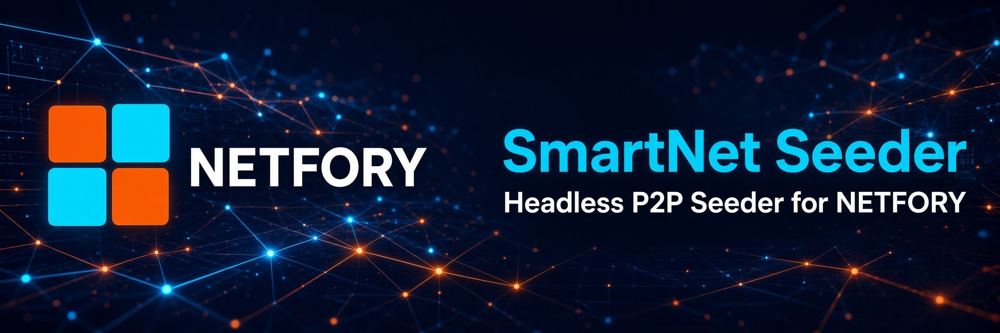

# smartnet-seeder



Headless, GUI-less P2P **seeder** for the SmartNet network. Run it on any cheap
VPS (no X / no webkit) to keep dApps alive 24/7 - it learns the app directory
from the trackers, pulls each app's content-addressed blob over iroh-blobs and
re-serves the **identical** blob, multiplying availability ("seeding").

It speaks the exact same wire protocol as the desktop client (iroh preset N0 +
LAN mDNS, `iroh_blobs::ALPN`, tracker `POST /announce` + `GET /apps`). The
signed `{merkle, signature, publicKey}` are read from each app's `content.json`
inside the tar, so the seeder's relay re-announce verifies on the tracker
unchanged.

## Build

```bash
cd seeder
cargo build --release        # binary: target/release/smartnet-seeder
```

## Run

```bash
./smartnet-seeder                 # uses ./config.yaml (auto-created on first run)
./smartnet-seeder /etc/sn.yaml    # custom config path
RUST_LOG=smartnet_seeder=info ./smartnet-seeder
```

Run it under systemd / `tmux` / `nohup ... &` to seed around the clock.

## config.yaml

```yaml
data_dir: ./smartnet-seed-data     # blobs + state live here
storage_limit_gb: 5.0              # disk budget for seeded blobs
trackers:
  - http://159.69.188.60:7374
  - http://91.99.119.119:7374
reward_address: ""                 # SmartHoldem S... address for future rewards
reward_passphrase: ""              # OR derive the address from this passphrase
poll_interval_secs: 30
relay_only: false                  # true = hide direct IP (relay only, no mDNS)
metrics_port: 9466                 # HTTP /metrics (JSON) + status page (0 = off)
metrics_interval_secs: 300         # also print a one-line STATS summary this often
```

## Metrics / contribution stats

The seeder serves a tiny dependency-free HTTP endpoint on `metrics_port`:

- `GET /metrics` → JSON: `{ uptimeSecs, appsSeeded, bytesSeeded, gbSeeded,
  storageLimitGb, endpointId, rewardAddress, trackers, lastAnnounceAcks }`
- `GET /` → a small dark status page (uptime, apps, GB, acks, reward address).

It also prints a one-line `STATS · uptime … · seeding N app(s) · X/Y GB · last
acks …` summary to the log every `metrics_interval_secs`. VPS operators can
scrape `/metrics` (Prometheus-style polling) to see their contribution, and the
`rewardAddress` ties that contribution to a payout identity for future
seeding-reward ranking.

`reward_address` / `reward_passphrase` are reserved for the upcoming
seeding-reward + proof-of-storage system. The passphrase derives the address
with the same scheme as the SmartNet wallet, so you can import the same phrase
into the wallet to control the rewards.

State (`seeded.json`) + the iroh blob store persist across restarts, so a
restart re-announces immediately without re-downloading.
